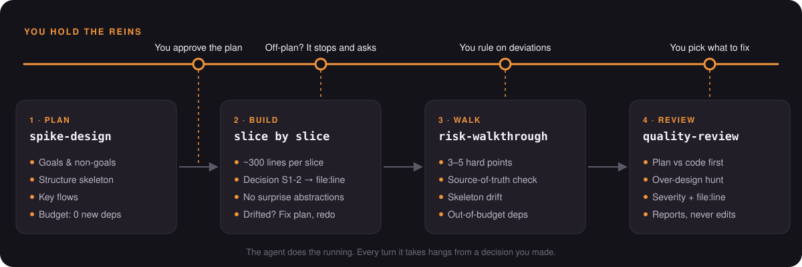
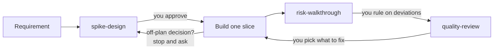

<div align="center">


# reins

**AI does the running. You hold the reins.**

Three agent skills that keep a coding agent on the plan you approved: plan first, build in traceable slices, then check every decision against the plan.

[](LICENSE)


[简体中文](https://github.com/Gamehu/reins) · **English**



</div>

## Why

Coding agents are fast and capable. Left alone, they also wander:

| Left alone, the agent… | With reins… |
|---|---|
| adds an interface "in case we need it later" | every new abstraction sits in a budget that starts at **0** and needs a reason |
| pulls in a library or a cache nobody asked for | each new dependency is justified *before* any code is written |
| quietly rebuilds data that another system owns | the **source of truth** is written into the plan and checked first in review |
| lets the scope grow one "small improvement" at a time | decisions outside the plan **stop the agent** until you approve them |
| reviews its own work and finds it "looks good" | review starts with **plan vs code**, done in a fresh context |

reins does not make the agent slower or dumber. It makes sure every turn it takes traces back to a decision **you** made.

## The three skills

### 1 · `spike-design`: plan before code

Turns a requirement, POC or spike into a plan you can actually review, and writes **no code** until you approve it.

- Goals, acceptance criteria and explicit **non-goals**
- Constraints, with each claim about external systems tagged *measured*, *read in code* or *inferred*
- A **structure skeleton**: new modules, core types and interface signatures
- **Key flows** for the 3–5 hard parts: input, steps, where it stops on failure, output
- An **abstraction and dependency budget** that defaults to zero
- **Slices** of about 300 lines, each with numbered decisions (`S1-1`, `S1-2`…) that implementation and review trace back to

### 2 · `risk-walkthrough`: show me the hard parts

Code is too long to read line by line, so after each slice the agent explains only what needs a human eye, and lists where it drifted.

- 3–5 hard points (transactions, concurrency, auth, external calls, state machines), each with its invariant, failure state and test coverage
- Deviation check, in this order: **source of truth** → **skeleton** → **budget** → non-goals → slice boundaries
- Every deviation is labeled either *needs your decision* or *already in the plan* (with the plan's file and line). Nothing in between.

### 3 · `quality-review`: an independent review

A reviewer with no memory of how the code was written. It reports and never edits.

- **Plan check first**: every decision in the diff is mapped to a plan entry; anything else is flagged *off-plan*, *differs from plan* or *not implemented*
- Readability, professional idioms, **over-design**, tests ("which test fails if this logic is removed?"), data and security
- Findings sorted by severity, each with `file:line`, what it is now and a simpler or more idiomatic version
- Small diffs are reviewed inline; larger ones go to a fresh-context subagent. Optional [P3C](https://github.com/alibaba/p3c) for Java and open-code-review run only when you say so.

<details>
<summary><b>What the output looks like</b></summary>

`risk-walkthrough` ends with decisions you answer by number:

```markdown
## Deviation check
- Source of truth: role → permission mapping rebuilt locally in `PermissionMap.java:12`;
  the plan says the identity provider owns it (plan.md:41) → needs your decision
- Skeleton: `RetryPolicy` interface is not in the skeleton, one implementation → needs your decision

## For you to decide
1. Drop the local permission map and read it from the provider → Recommended: yes
2. Inline `RetryPolicy` into the client → Recommended: yes
```

`quality-review` puts the plan check before anything else:

```markdown
## Plan check
- Plan: docs/plans/export.md
- `ExportService.java:88` off-plan: retries 3 times on timeout → closest entry: S2-3
- `S2-4` not implemented: export is not limited to the caller's tenant

## Must fix
- `ExportService.java:120` loads every row and filters in memory [subagent]
  - Now: `findAll().stream().filter(...)`
  - Better: a query with a `WHERE tenant_id = ?` and paging
```
</details>

## Quick start

```bash
git clone https://github.com/Gamehu/reins-en.git ~/reins-en
```

Link the skills into the global skill folder of each tool you use:

```bash
# Claude Code (OpenCode reads this folder too)
mkdir -p ~/.claude/skills
for s in spike-design risk-walkthrough quality-review; do ln -s ~/reins-en/skills/$s ~/.claude/skills/$s; done

# Codex and OpenCode
mkdir -p ~/.agents/skills
for s in spike-design risk-walkthrough quality-review; do ln -s ~/reins-en/skills/$s ~/.agents/skills/$s; done
```

To use them in a single project only, link into that project's `.claude/skills/` or `.agents/skills/` instead. `git pull` keeps every tool up to date.

## Using it



Skills trigger on their own when what you say matches their description, such as *"let's discuss the plan first"* or *"review this"*. At the hand-offs it is more reliable to name them:

- **Claude Code**: `/spike-design`, `/risk-walkthrough`, `/quality-review`
- **Codex / OpenCode**: *"use spike-design to plan this"*

Tip: write the order into your project's `CLAUDE.md` or `AGENTS.md`:

```markdown
- Technical plans come from `spike-design`. After implementing, run `risk-walkthrough`, then `quality-review`.
```

## Principles

- **Decisions, not lines.** Mechanical code (wiring, fields, mapping, logging, tests) needs no plan entry. New business rules, data sources, abstractions, dependencies, config and failure strategies do.
- **A budget of zero.** Every abstraction and dependency must say why it is needed *now* and what the code looks like without it.
- **Don't patch drift.** When a slice's structure moves away from the skeleton, fix the plan and redo the slice. Whether to throw away the code is your call.
- **Show your sources.** Claims about other systems carry their source; numbers come from command output, not memory.
- **Any language.** The skills are written in English; the agent answers in whatever language you use.

## Works with superpowers

If the requirement itself is still fuzzy, clarify it first with [superpowers](https://github.com/obra/superpowers)' `brainstorming`. Once its design doc is approved, go to `spike-design` instead of `writing-plans`. `spike-design` adopts the goals, non-goals and constraints already written there and only asks about the gaps.

## Optional extras

The core of every skill needs nothing but the agent. `quality-review` can also use:

| Extra | When | Requirements |
|---|---|---|
| **P3C** (Alibaba Java Coding Guidelines) | Java changes | `java` on the path. On first run, PMD 6.15.0, p3c-pmd 2.1.1 and kotlin-stdlib are downloaded to `~/.cache/p3c-check` (override with `P3C_HOME`) and checked against pinned SHA-256 hashes |
| **open-code-review** (`ocr`, npm `@alibaba-group/open-code-review`) | Only after you agree, every time | Slow and token-hungry on big diffs, so it is off by default |

Built-in language rules cover [Java](skills/quality-review/references/java.md) and [TypeScript](skills/quality-review/references/ts.md); other languages use the general checklist. Your project's own conventions (`CLAUDE.md`, `AGENTS.md`, `CONTRIBUTING.md`…) always win over the built-in rules.

## FAQ

<details>
<summary><b>Isn't this a lot of process for a small change?</b></summary>

The ceremony scales down. A plan for a small task is short, small diffs are reviewed inline without a subagent, and a missing plan is simply noted instead of blocking the review.
</details>

<details>
<summary><b>Does the plan have to match the code line by line?</b></summary>

No. A 100-line plan for 1,000 lines of code is normal. Only decisions are traced; the code that carries out a decision belongs to that decision.
</details>

<details>
<summary><b>Will it fix the problems it finds?</b></summary>

No. `risk-walkthrough` and `quality-review` only report. You answer by number ("1 accept, 2 change"), and the agent then updates the plan or the code.
</details>

<details>
<summary><b>Can I see how the skills actually ran?</b></summary>

[skill-trace](https://github.com/Gamehu/skill-trace) replays every skill run: what you asked, where you stepped in and what it delivered.
</details>

## Layout

```
skills/
  spike-design/SKILL.md
  risk-walkthrough/SKILL.md
  quality-review/
    SKILL.md
    references/        java.md, ts.md
    scripts/           p3c-check.sh, p3c-all.xml
docs/assets/           images used in this README
```

## Chinese edition

This is the English edition of reins. The rules are written first in the Chinese edition, [Gamehu/reins](https://github.com/Gamehu/reins), and then synced here.
Install only one edition: both use the same skill names.

Synced from Gamehu/reins@653380c.

## Contributing

Issues and pull requests are welcome. Keep the skills generic: no project names, commands or tool-specific paths in the rules, and no rule that fixes the output language.

## License

[MIT](LICENSE) © Gamehu
